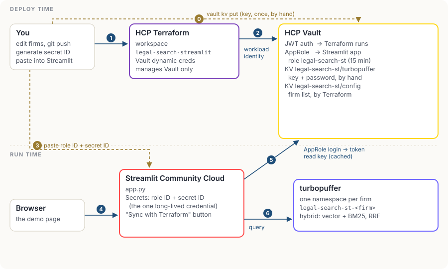

# Counsel Search on Streamlit: turbopuffer + HCP Vault + HCP Terraform

> **A personal hobby project.** Built to learn and demo how these products fit together. Not affiliated with or endorsed by turbopuffer or HashiCorp, not production code. Every law firm, contract and counterparty is invented.

The same multi-tenant contract search as [tpuf-legal-search-aws](../tpuf-legal-search-aws), built for Streamlit Community Cloud. Each law firm gets its own turbopuffer namespace; lawyers search clauses across that firm's contracts with hybrid search and filters.

The difference is identity. Streamlit Cloud gives the app no cloud identity to prove to Vault, so the app starts from one credential, an AppRole role ID and secret ID. Everything after that is short-lived and comes from Vault.



## How the pieces fit

```
   Streamlit Secrets: VAULT_ROLE_ID + VAULT_SECRET_ID   ← the only credential the app holds ("secret zero")
        │ AppRole login
        ▼
   Vault token (15 min) ──▶ legal-search-st/turbopuffer  {api_key, demo_password}   written by hand
                        └─▶ legal-search-st/config       {firms: {...}}             written by HCP Terraform
        │
        ▼
   turbopuffer  namespace "legal-search-st-<firm>"  (BM25 + native embedding, hybrid via RRF)

   HCP Terraform (Vault dynamic credentials) manages: AppRole + policy + the tenant list
   "Sync with Terraform" in the sidebar seeds or deletes namespaces to match the list
```

| Product | What it does here |
|---|---|
| **turbopuffer** | One namespace per firm, native embedding, hybrid search with RRF, filters on contract type, governing law and year. |
| **HCP Vault** | AppRole auth for the app; KV holds the turbopuffer key, the demo password and the tenant list. The app re-reads them every 2 minutes and on any 401, so key rotation needs no redeploy. |
| **HCP Terraform** | Runs with Vault dynamic credentials (JWT workload identity, no stored token). Manages the AppRole, its policy and the tenant list. |
| **Front end** | Streamlit: firm picker, filters, results, the exact SDK call, and a sidebar showing the Vault token, secret version and a tenant "plan". |

## Setup

Everything, including the Vault cluster, is Terraform. One script runs it in order.

**Before you start** (in a browser, about 10 minutes)

1. Create an HCP organization. New ones get trial credits that cover the Vault cluster.
2. In it, create a project (e.g. `tpuf-demos`). Under that project's **Access control (IAM) → Service principals**, create one with the **Contributor** role and generate a key. Scoping it to the project means it can't touch anything else.
3. Create an HCP Terraform organization, and a user token with an expiry date (User settings → Tokens).
4. Have a turbopuffer API key ready.
5. Optional, for the commit-driven demo: connect HCP Terraform to GitHub once. Either use the built-in **GitHub App** (connect any workspace to GitHub.com (GitHub App) in the UI and install the app on your account), or add an OAuth provider under **Organization settings → Version Control → Providers**. Then set `VCS_REPO` below; `setup.sh` finds whichever connection exists.

**Run it** (needs `terraform`, `vault`, `curl` and `python3`)

```bash
export HCP_CLIENT_ID=...  HCP_CLIENT_SECRET=...  HCP_PROJECT_ID=...
export TFE_TOKEN=...  TF_CLOUD_ORGANIZATION=your-org
export TURBOPUFFER_API_KEY=tpuf_...  DEMO_PASSWORD=choose-one   # optional, see below
export VCS_REPO=jgerson/tpuf-legal-search-streamlit             # optional: GitHub-driven runs
./scripts/setup.sh
```

| Step | What happens | Where state lives |
|---|---|---|
| 1 | `hcp/` creates a HashiCorp Virtual Network, a Development-tier Vault cluster with a public endpoint, and a 6-hour admin token | HCP Terraform workspace `tpuf-demos-vault-cluster` (local execution) |
| 2 | `bootstrap/` uses that token once: KV mount, JWT trust for HCP Terraform, and the `legal-search-streamlit` workspace with Vault dynamic credentials | `legal-search-streamlit-bootstrap` (local execution) |
| 3 | Writes the turbopuffer key into Vault, or stops and tells you how to add it yourself | Vault only, never Terraform state |
| 4 | Runs the `legal-search-streamlit` workspace remotely: AppRole, policy, firm list. With `VCS_REPO` set, the workspace is connected to GitHub and the run is started and confirmed through the API (`scripts/tfc-run.sh`), using the code on `main` | `legal-search-streamlit` |
| 5 | Writes `.streamlit/secrets.toml` (gitignored) with the role ID and a fresh secret ID | your machine |

If someone else runs the script for you, leave `TURBOPUFFER_API_KEY` unset. The script stops at step 3 with instructions for adding the key yourself through the Vault web UI, and you re-run it to finish. That way the key only ever goes from you to Vault.

The script is safe to re-run; every step is a Terraform apply.

**Deploy on Streamlit Community Cloud** with `app.py` as the entry point and Python 3.12 (under Advanced settings), and paste `.streamlit/secrets.toml` into App settings → Secrets. Open the app and press **Sync with Terraform** to seed the firms. If your turbopuffer account isn't in `aws-us-east-1`, add `TURBOPUFFER_REGION = "..."` to the secrets.

Running locally instead: `pip install -r requirements.txt` and `streamlit run app.py`; it reads the same `.streamlit/secrets.toml`.

**When you're done for the day:** `./scripts/teardown.sh` deletes the firms' turbopuffer namespaces, then destroys the workspace resources, the bootstrap config and the cluster, so nothing keeps billing. `setup.sh` rebuilds it all (you'll need to write the turbopuffer key again).

Prefer doing it by hand? Create the cluster in the HCP portal, then run `bootstrap/` and `terraform/` yourself with the same variables the script passes.

## Demo script (about 10 minutes)

1. **The workspace.** Show HCP Terraform's variables: no Vault token, just `TFC_VAULT_*` settings. Each run logs into Vault with a short-lived workload identity token.
2. **Search.** Pick a firm, ask *"what's our liability cap and what's excluded?"*, switch Hybrid / Vector / BM25, add filters, open *SDK call*.
3. **Tenancy.** Switch firm: same question, different contracts, separate namespace.
4. **Onboard a firm with a commit** (needs `VCS_REPO`). On GitHub, edit `terraform/terraform.tfvars` and add a line such as `"cobalt-mercer" = { name = "Cobalt Mercer LLP" }`, then commit to `main`.
   - HCP Terraform starts a run by itself, because the commit touched `terraform/`. The plan shows one change: the firm list in Vault is updated in place.
   - Click **Confirm & apply**. Auto-apply is off on purpose, so every tenant change is reviewed.
   - In the app, press **Re-read key now** (it also refreshes the firm list). The sidebar shows `legal-search-st-cobalt-mercer` as *to seed*. Press **Sync with Terraform**, pick the firm and search. The first query may be slightly slower while turbopuffer loads the new namespace into cache.
   - To offboard, delete the line and commit. After you confirm the run, the firm shows as *to delete* and Sync removes its namespace.
5. **Rotate the key.** Create a second turbopuffer key, `vault kv put` it, press **Re-read key now**. Version and key prefix change in the sidebar; search keeps working. Revoke the old key; the 401 handler covers anything still holding it.
6. **Talk about secret zero.** The secret ID in Streamlit is long-lived (30 days here) and can't be bound to an IP, because Streamlit Cloud's egress isn't stable. On AWS, GCP or Kubernetes the app proves its identity with its platform role instead. That's the AWS version of this demo.

## Rebuild and demo (runbook)

The whole cycle from your Mac's Terminal: tear down, set up again, then demo adding a firm.

**One-time prep**

```bash
brew tap hashicorp/tap && brew install hashicorp/tap/terraform hashicorp/tap/vault
git clone https://github.com/jgerson/tpuf-legal-search-streamlit   # first time; afterwards `git pull`
cd tpuf-legal-search-streamlit
chmod +x scripts/*.sh
cp env.template .env          # first time only, then fill it in
```

In `.env`, `HCP_PROJECT_ID` is just the project's ID, `TFE_TOKEN` is a **user** token, and `VCS_REPO=jgerson/tpuf-legal-search-streamlit` turns on GitHub-driven runs. In every new Terminal window, load it first:

```bash
set -a; source .env; set +a
```

**1. Tear down** (about 10 minutes): `./scripts/teardown.sh`

1. Deletes the firms' turbopuffer namespaces and their contracts (`scripts/delete-namespaces.sh`), using the key from Vault while Vault still exists. Set `KEEP_NAMESPACES=1` to keep them; `./scripts/delete-namespaces.sh --dry-run` lists what would go.
2. Starts a destroy run in HCP Terraform: the app's login, its policy and the firm list are removed from Vault.
3. Deletes the workspace, the Vault trust for HCP Terraform, and the secret store holding the turbopuffer key.
4. Deletes the Vault cluster and its network. HCP billing stops here.

Left in place, all free: your HCP and HCP Terraform organizations, the service principal, the GitHub repo and GitHub App, and the Streamlit app.

**2. Set up again** (about 15 minutes): `./scripts/setup.sh`

1. Creates a new Vault cluster (about 10 minutes).
2. Sets up the Vault trust and recreates the workspace, connected to GitHub.
3. Writes your turbopuffer key and demo password into Vault.
4. Starts and confirms a run from GitHub: the app's login, its policy and the firm list.
5. Writes new Streamlit secrets to `.streamlit/secrets.toml`.

The new cluster has a new address and new credentials, so update Streamlit:

```bash
pbcopy < .streamlit/secrets.toml
```

Then in Streamlit: your app → **Settings → Secrets** → paste over the old contents → **Save**. Open the app and log in. The firms show as *to seed*; press **Sync with Terraform** to create their namespaces and load the contracts.

**3. Demo adding a firm** (about 3 minutes)

1. In the app, show the existing firms and run a search.
2. On GitHub, edit `terraform/terraform.tfvars`, add `"cobalt-mercer" = { name = "Cobalt Mercer LLP" }`, and commit to `main`.
3. In HCP Terraform, a run starts by itself. The plan shows one change: the firm list in Vault. Point out that the run logged into Vault with a short-lived identity and can't read the turbopuffer key. Click **Confirm & apply**.
4. In the app, press **Re-read key now**. Cobalt Mercer shows as *to seed*. Press **Sync with Terraform**, pick it and search. The first query can be slightly slower while turbopuffer loads the new namespace into cache.
5. Optional offboarding: delete the line, commit, confirm the run, and Sync. The namespace is removed.

**Before each demo:** check that `terraform.tfvars` on GitHub doesn't already contain the firm you're about to add. If a rehearsal left it there, delete the line, commit, confirm, and Sync, so the onboarding starts fresh.

## Running costs (approximate, October 2026)

| Item | Cost |
|---|---|
| turbopuffer, Launch plan | $16/month minimum; this demo's usage is far below it |
| HCP Vault Dedicated, Development tier | about $0.62 per cluster-hour, roughly $450 if left running all month. Create it for prep and demo days and delete it after; bootstrap plus a workspace run rebuilds the config in minutes |
| HCP Terraform | Free tier covers 500 managed resources; this demo uses a handful per workspace |
| Streamlit Community Cloud | Free |

## Trade-offs worth saying out loud

- **Secret zero.** The AppRole secret ID is the one long-lived credential. Mitigations here: it expires after 30 days, it can only read three paths, and every login shows in Vault's audit log. A platform with workload identity removes it.
- **The turbopuffer key is static and org-wide.** turbopuffer keys apply to every namespace in the org and there's no public key-management API, so Vault stores the key rather than minting short-lived ones. Tenant isolation is enforced by the app using the Terraform-managed firm list.
- **Sync is a button, not automatic.** Terraform can't call into Streamlit Cloud, so onboarding is "Terraform changes the desired state, the app reconciles". The AWS version does it inside the Terraform run.
- **One shared demo password**, stored in Vault, so a public app doesn't run up your bill. A real app would use SSO and map users to firms.

## Cleaning up

`./scripts/teardown.sh` removes everything, including the firms' turbopuffer namespaces. To keep the namespaces, run it with `KEEP_NAMESPACES=1`.
